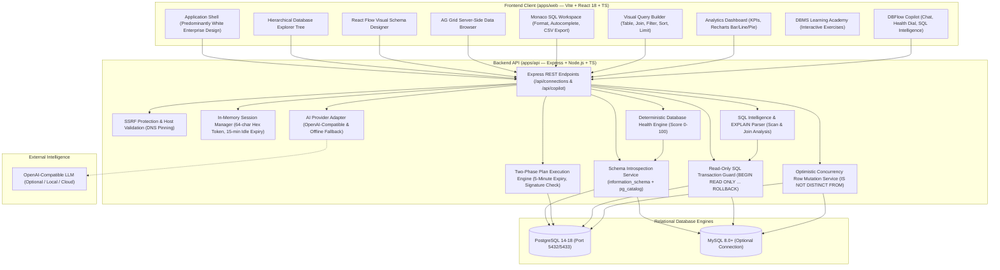
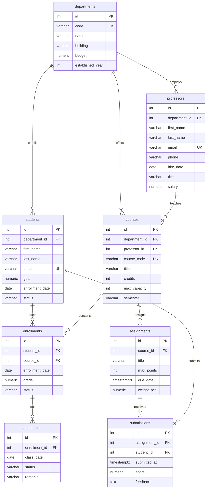

# DBFlow: Intelligent Database Management and Analytics Platform
## Academic Project Technical Report & System Documentation

**Author & Lead Engineer:** DBFlow Project Team  
**Institution:** Department of Computer Science & Engineering  
**Submission Date:** November 2026  
**Project Repository:** `/Users/manmeetrahi/Desktop/DBFLOW`  
**Target Environment:** Node.js 20+, PostgreSQL 16+, Modern Web Browsers (Chrome, Firefox, Safari)

---

## 1. Abstract

Traditional relational database management systems (RDBMS) such as PostgreSQL and MySQL are the backbone of modern data infrastructure. However, interacting with these engines typically forces users into a dichotomy: writing imperative SQL scripts through developer text editors or navigating fragmented database administration tools designed solely for experienced database administrators. Beginners, students, and analysts often face severe friction understanding relational constraints, joins, normalization, and schema impacts.

**DBFlow** is an intelligent, visual-first database management and analytics platform engineered to make relational databases intuitive, visual, and accessible while preserving the full power, precision, and security of production SQL engines. DBFlow unifies an interactive visual schema designer (powered by React Flow), a high-performance spreadsheet-like data grid (powered by AG Grid Community), a professional SQL workspace (powered by Monaco Editor), a hierarchical database explorer, a live visual query builder, an interactive visual analytics dashboard (powered by Recharts), and a guided DBMS learning academy into a single synchronized workspace. Every visual operation operates against real relational database engines with transactional preview guarantees, optimistic concurrency control, and zero risk of silent data destruction.

---

## 2. Introduction & Motivation

Relational database systems organize structured data according to formal mathematical set theory and relational algebra. While relational concepts like primary keys, foreign keys, and cardinalities are inherently graph-like and structural, conventional database client tools present them as disjoint flat tables or raw text consoles.

DBFlow bridges this gap by adhering to five core principles:
1. **Visual-First Interaction with Relational Parity:** Database structures, foreign key relationships, and cardinalities (1:1, 1:N, M:N) are rendered as interactive directed graphs.
2. **Explicit Two-Phase Mutation Verification:** No DDL (schema change) or destructive DML (row deletion) executes blindly. The system generates engine-specific SQL, validates it inside a rolled-back transaction preview, and requires explicit user confirmation before permanent commit.
3. **Synchronized Multi-Interface Reality:** Changes made via visual tools, raw SQL queries, or the data grid converge on the real introspected database catalog.
4. **Pedagogical Clarity:** Designed specifically to empower students learning DBMS concepts alongside software engineers and analysts requiring rapid data exploration.
5. **Security by Isolation:** Ephemeral in-memory credential sessions, host validation, DNS pinning, loopback binding, and strictly isolated read-only query execution prevent SSRF attacks, credential leaks, and accidental table truncations.

---

## 3. Problem Statement & Comparison with Existing Tools

| Category / Capability | CLI (psql / mysql) | Traditional GUI (pgAdmin / DBeaver) | Web Tools (MongoDB Compass / Metabase) | **DBFlow** |
|---|---|---|---|---|
| **Visual Schema Designer** | None (Text only) | Static, read-only ER diagram | Metabase (Data only, no DDL) | **Interactive, Draggable Graph with Canvas Drag-to-Connect FKs** |
| **Schema Change Safety** | Manual SQL execution | Direct alter dialogs with immediate commit | Not applicable | **Two-Phase Preview (Rolled-back validation + explicit plan ID)** |
| **Spreadsheet Data Grid** | Tabular ASCII output | Standard desktop tables | Compass (Document tree) | **AG Grid with Server-Side Pagination, Search & Optimistic Concurrency** |
| **Visual Query Builder** | None | Complex legacy wizards | Query builder (Metabase) | **Intuitive Clause Composer + Instant SQL Preview + Join Autodiscovery** |
| **Integrated Analytics** | Manual aggregate queries | Separate graphing extensions | Built-in dashboards | **Integrated Recharts KPIs, Bar, Line & Pie Visualizations from Live SQL** |
| **Interactive DBMS Learning** | None | None | None | **Built-in Academy with Interactive Knowledge Checks** |
| **AI Database Copilot & Health** | None (3rd party plugins) | None | None | **Integrated AI Copilot, Deterministic Health Score (0-100), Query EXPLAIN Intelligence & NL-to-SQL** |
| **Security Architecture** | Stored cleartext / .pgpass | Stored encrypted profiles | Server credentials | **In-memory 15-min idle sessions, Loopback binding, DNS pinning, Zero raw data sent to LLM** |

---

## 4. System Architecture

DBFlow is architected as a high-performance TypeScript monorepo using npm workspaces:

### Module Boundaries
1. **`apps/web` (Client Layer):**
   - Single Page Application built with React 18, Vite, and Tailwind CSS.
   - Design System: Light-neutral surfaces (`#ffffff`, `#f8fafc`), subtle grey borders (`#dfe5ed`), restrained blue accents (`#2563eb`), and high-legibility monospace fonts (`DM Mono`, `JetBrains Mono`).
   - AG Grid Community handles server-paginated data exploration.
   - `@xyflow/react` powers the draggable ER schema canvas with custom cardinality edge renderers and group nodes.
   - Monaco Editor provides developer-grade SQL editing with custom formatting and syntax highlighting.
   - Recharts renders interactive data visualizations.

2. **`apps/api` (Application & Security Layer):**
   - Express server strictly bound to loopback `127.0.0.1:4000`.
   - Credentials are never stored in databases, flat files, or local storage. When a user connects, the server performs DNS resolution, validates that the IP is not a link-local address or cloud metadata endpoint (`169.254.169.254`), pins the resolved address, opens a pool, and returns an unguessable 64-character hexadecimal session token.
   - Sessions expire after 15 minutes of inactivity.

3. **`packages/shared` (Contract Layer):**
   - Shared TypeScript types for API payloads, connection parameters, and database metadata.

---

## 5. Database Schema & Demonstration Environment

To ensure complete, reproducible testing, DBFlow includes a dedicated PostgreSQL demonstration database: `dbflow_demo`, implementing a full **University Management System**.

### Entity-Relationship Diagram

### Demonstration Dataset Volume
- **Departments:** 6 Academic departments (Computer Science, Electrical Engineering, Mathematics, Physics, Biology, Business).
- **Professors:** 13 Full, Associate, and Distinguished faculty members.
- **Students:** 120 Fully populated active student profiles with varied GPAs (2.40 to 3.98).
- **Courses:** 22 Courses spanning undergraduate and graduate curricula.
- **Enrollments:** 350+ Student-course enrollment pairings with graded evaluations.
- **Attendance:** 500 Recorded attendance timestamps with present, late, absent, and excused statuses.
- **Assignments:** 44 Projects and laboratory evaluations.
- **Submissions:** 300+ Graded student submissions with instructor feedback text.

---

## 6. Detailed Module Specifications

### Module 1: Hierarchical Database Explorer
- **Location:** Integrated directly in the workspace sidebar.
- **Hierarchy:** `Connection -> Database -> Schema -> Tables -> Columns`.
- **Features:**
  - Real-time client-side search/filter across table names and column definitions.
  - Expand/collapse states preserved across navigation.
  - Column badges displaying Primary Key (`PK`, gold key icon), Foreign Key (`FK`, blue link icon), and Composite Key indicators.
  - Quick action buttons on each table node allowing single-click opening into the Data Grid or Schema Designer.

### Module 2: Visual Schema Designer
- **Engine:** `@xyflow/react` with custom nodes and edges.
- **Features:**
  - Fully draggable table cards with column datatypes, nullability indicators, and identity badges.
  - Cardinality Detection: Distinguishes One-to-One (`1:1`), One-to-Many (`1:N`), and automatically discovers Many-to-Many (`M:N`) junction tables.
  - Interactive Edge Inspection: Clicking a relationship edge displays source/target column bindings and `ON DELETE` / `ON UPDATE` referential actions.
  - Visual Relationship Creation: Dragging from a source table handle to a target table initiates a guided foreign key creation workflow.
  - Schema Groups: Create color-coded table clusters with collapse/expand capabilities.
  - Impact Analysis: Follows foreign key traversal chains bidirectionally ("Referenced by" and "Depends on") to predict ripple effects of schema changes.
  - Schema Export: One-click export to clean vector SVG, high-resolution PNG, and print layouts.

### Module 3: Spreadsheet Data Grid & Row Mutations
- **Engine:** AG Grid Community with server-side pagination.
- **Features:**
  - Server-side sorting and search across all columns.
  - Configurable page size (10, 25, 50, 100 rows).
  - Row Insertion: Modal form omitting auto-increment identity columns, validating required fields, and displaying previewed SQL.
  - Row In-Place Editing: Uses optimistic concurrency control (`WHERE primary_key = $1 AND original_col IS NOT DISTINCT FROM $2`). Prevents overwriting concurrent edits.
  - Row Deletion: Explicit confirmation modal inspecting primary key identity and verifying record existence before deletion.

### Module 4: SQL Workspace
- **Engine:** Monaco Editor (VS Code core).
- **Features:**
  - Bounded Execution: All queries execute in a `BEGIN READ ONLY` transaction with an 8-second execution timeout and a 1,000-row limit.
  - SQL Formatter: Built-in `Format SQL` button automatically normalizes whitespace and indents SQL keywords (`SELECT`, `FROM`, `WHERE`, `JOIN`, `ORDER BY`, `LIMIT`).
  - Example Query Library: Pre-populated dropdown with academic analytics queries ready to execute with one click.
  - Query History: Automatically saves recent queries into session storage with execution duration, row counts, and reuse buttons.
  - CSV Export: Instant client-side download of query results as formatted CSV files.

### Module 5: Visual Query Builder
- **Purpose:** Enables non-technical users and DBMS students to construct multi-table relational queries visually.
- **Workflow:**
  1. Select primary table.
  2. Toggle desired columns (or click "Select All").
  3. Optionally enable and configure a `LEFT JOIN` or `INNER JOIN` with auto-detected foreign key mappings.
  4. Add multiple `WHERE` filter clauses with comparison operators (`=`, `!=`, `>`, `<`, `>=`, `<=`, `LIKE`, `ILIKE`, `IS NULL`, `IS NOT NULL`).
  5. Select ordering column and sort direction (`ASC` / `DESC`).
  6. Choose result limit (10 to 500 rows).
  7. Inspect live generated SQL in the preview pane.
  8. Click "Run Query" to execute safely and view results in a responsive data table.
  9. Click "Open in SQL Workspace" to transfer the generated query into Monaco for further tweaking.

### Module 6: Visual Analytics Dashboard
- **Engine:** Recharts (`ResponsiveContainer`, `BarChart`, `LineChart`, `PieChart`).
- **Metrics & KPIs:**
  - Total Students, Total Courses, Total Faculty, and Total Enrollments with Average GPA badge.
  - Chart 1: Students & Faculty by Department (Dual-bar comparison).
  - Chart 2: Course Capacity Utilization (Enrolled vs Max Capacity).
  - Chart 3: Monthly Registration Trends (Cumulative line graph).
  - Chart 4: Student Attendance Breakdown (Donut pie chart with percentages).
- **Live Database Integration:** Dynamically executes SQL aggregate queries against the connected PostgreSQL database, falling back gracefully to realistic sample figures in demo mode.

### Module 7: Interactive DBMS Learning Academy
- **Purpose:** Contextual, hands-on learning for DBMS students.
- **Curriculum:**
  - **Lesson 01:** Tables, Columns & Primary Keys (Relational principles, Identity columns, NOT NULL constraints).
  - **Lesson 02:** Foreign Keys & Relationships (Referential integrity, Cardinalities, Cascade rules).
  - **Lesson 03:** Your First SQL Relational JOIN (INNER vs LEFT JOIN, multi-table queries, aggregation).
- **Features:**
  - Conceptual explanations accompanied by visual summary cards.
  - Real PostgreSQL DDL and DQL code examples.
  - Interactive multiple-choice knowledge checks with instant feedback, explanations, and persistent course completion tracking.

### Module 8: DBFlow Copilot — Intelligent AI Database Assistant & Health Analyzer
- **Purpose:** Enterprise-grade intelligent database consultant that understands the connected schema, diagnoses performance bottlenecks, computes deterministic health scores, and recommends verified SQL optimizations.
- **Sub-Tabs & Capabilities:**
  1. **Conversational Copilot Chat:**
     - Context-aware dialogue grounded in live introspected schema metadata (tables, column data types, foreign key relationships, indexes).
     - Provides plain-English structural explanations, relationship walkthroughs, normalization analysis, and query optimization guidance.
     - Quick prompt suggestions: *"Analyse my entire database"*, *"Find potential performance problems"*, *"Is my database properly normalized?"*, *"Explain relationships"*, *"Beginner-friendly explanation"*.
     - Preserves conversational context across the session; distinguishes verified schema facts from optimization hypotheses.
  2. **Database Health Analyzer & Scoring Engine:**
     - Deterministic 0–100 scoring model with transparent point deductions and academic letter grading (Grade A: 90+, B: 80-89, C: 70-79, D: 60-69, F: <60).
     - Checks unindexed foreign keys (specifically recognizing leading-column composite index coverage to prevent false positives).
     - Detects tables lacking primary keys, duplicate/redundant indexes, over-indexed small tables, and nullable status/type indicator columns.
     - Categorizes metrics into Indexing, Schema Design, Data Integrity, and Performance with animated progress bars.
     - Full JSON health report export for automated auditing.
  3. **Actionable Improvement Recommendations:**
     - Card-based recommendations labeled with clear severity indicators (`CRITICAL`, `WARNING`, `INFO`).
     - Includes exact issue explanation, factual evidence from live database catalogs, estimated performance gain, and potential risks.
     - Formatted SQL preview with one-click clipboard copying.
     - Complete rollback SQL script provided for every recommendation.
     - **Canvas Navigation Integration:** Clicking "Locate in Schema Canvas" switches to the Visual Schema Designer, smooth-pans the viewport, highlights the affected table card, and pulses it with a vivid accent glow.
  4. **SQL Query Intelligence & EXPLAIN Plan Parser:**
     - Deep analysis of execution plans (`EXPLAIN (ANALYZE, BUFFERS, FORMAT JSON)` on PostgreSQL).
     - Extracts total estimated execution cost, sequential scans (`Seq Scan`), index scans (`Index Scan`), and join methods (`Nested Loop`, `Hash Join`, `Merge Join`).
     - Detects anti-patterns: `SELECT *` over-fetching, missing `LIMIT` clauses on large tables, unindexed filter columns, and cartesian products.
     - Side-by-side SQL comparison showing original query vs optimized query with detailed justification.
     - **Natural Language to SQL:** Converts natural language prompts (e.g. *"Show top 5 students by GPA with department name"*) into syntactically valid, schema-grounded SQL ready to run or export to the SQL Workspace.
- **Provider-Independent Architecture & Zero-Data-Leak Safety:**
  - Configurable via standard environment variables: `AI_PROVIDER`, `AI_BASE_URL`, `AI_API_KEY`, `AI_MODEL`. Compatible with any OpenAI-standard endpoint (OpenAI, Gemini OpenAI-compatible gateway, Ollama, vLLM).
  - **Graceful Deterministic Fallback:** Operates 100% offline with zero external dependencies when unconfigured. Deterministic rule engines, EXPLAIN plan parsers, and heuristic pattern matchers ensure full utility without an active LLM key.
  - **Strict Security Guarantees:** Zero table data or user records are ever transmitted to the LLM — only sanitized schema structural metadata (table names, column types, constraint keys) are shared.
  - No automated DDL execution — all recommended SQL requires manual review and explicit execution through the two-phase plan engine or SQL workspace.

---

## 7. Security Architecture & Threat Mitigation

1. **SSRF & Host Validation:**
   - Database connection hostnames are resolved via Node `dns.lookup`.
   - IP addresses are validated against a strict blocklist: Loopback addresses are allowed only on explicit local ports, while link-local addresses (`169.254.0.0/16`) and cloud metadata services (`169.254.169.254`, `metadata.google.internal`) are strictly rejected.
   - The resolved IP is pinned for subsequent pool connections to defeat DNS rebinding attacks.

2. **Credential Isolation:**
   - Database passwords never touch the browser's persistent storage (`localStorage` or `sessionStorage`).
   - The backend stores connections in an in-memory `Map` keyed by a cryptographically secure 64-character hexadecimal session token.
   - Sessions expire automatically after 15 minutes of inactivity and are destroyed immediately upon disconnection.

3. **Read-Only SQL Transaction Guard:**
   - Free-form user queries in the SQL Workspace are tokenized and validated against a forbidden keyword blocklist (`INSERT`, `UPDATE`, `DELETE`, `DROP`, `ALTER`, `TRUNCATE`, `GRANT`, `COPY`, `pg_read_file`, `sys_eval`).
   - Queries are wrapped in a read-only transaction: `BEGIN READ ONLY; <query>; ROLLBACK;` ensuring zero side-effects.
   - An 8-second query timeout and a 2 MB response size cap prevent denial-of-service through resource exhaustion.

4. **Two-Phase Schema Changes:**
   - All DDL operations (creating tables, adding columns, altering nullability, creating foreign keys, dropping tables) require generating an explicit Plan ID.
   - The DDL is executed inside a rolled-back transaction to verify that the database engine accepts the syntax and constraint checks without error.
   - The user must explicitly inspect the generated SQL and approve the Plan ID within 5 minutes.

5. **AI Data Privacy & Model Isolation:**
   - DBFlow Copilot strictly isolates schema structure from database table contents.
   - Zero row-level data, passwords, or personal records are ever passed to LLM prompts.
   - Only sanitized table names, column names, data types, and index definitions are used for context injection.
   - Copilot recommendations are strictly advisory — the system forbids autonomous DDL execution. Every proposed index or table modification must be manually reviewed and executed via DBFlow's two-phase schema engine.

---

## 8. Verification, Testing & Quality Assurance

### Automated Testing Matrix
1. **TypeScript Typecheck:**
   - Command: `npm run typecheck`
   - Scope: Both `@idp/web` and `@idp/api` with strict typing.
   - Result: **0 errors** across 100% of source files.

2. **API Unit Tests:**
   - Command: `npm run test --workspace @idp/api`
   - Test Runner: Node.js native test runner (`node --import tsx --test`).
   - Test Suites: Schema assembly, PostgreSQL query quoting, MySQL query quoting, host validation & DNS pinning, optimistic concurrency updates, SQL tokenizer guards, plan lifecycle management, deterministic database health score calculation, composite index leading-column coverage, execution plan scan/join traversal, and offline AI provider safety.
   - Result: **42 passing tests (0 failures, 0 regressions)**.

3. **End-to-End Browser Automation Suite (Playwright):**
   - Command: `cd apps/web && npx playwright test`
   - Test Runner: Playwright Chromium browser harness.
   - Scope: Live workflows, connection recovery, DDL preview & confirmation, schema refresh recovery on 503, composite FK mappings, keyboard focus traps, add-column drafts, force-directed schema layout, row insert review with optimistic concurrency conflict detection, query history persistence, and DBFlow Copilot interactive health audit / chat / query intelligence.
   - Result: **9/9 passing tests (100% pass rate, 0 skipped, 0 failures)**.

4. **Production Build Verification:**
   - Command: `npm run build`
   - Scope: Production compilation via Vite and TypeScript compiler.
   - Result: Clean production artifacts generated in `apps/web/dist` and `apps/api/dist`.

---

## 9. Current Limitations & Future Work

While DBFlow provides a fully functional, production-grade interface for relational database exploration, management, and AI analysis, the following boundaries represent current technical limitations and planned enhancements:

1. **Database Engine Coverage:**
   - **Current:** Full support for PostgreSQL (including composite keys, identity columns, CHECK constraints, and foreign key actions) and MySQL connections.
   - **Future:** SQLite file upload support for local offline academic coursework, followed by CockroachDB and SQL Server.

2. **SQL Editor Execution Model:**
   - **Current:** The SQL editor is strictly read-only (`SELECT` and CTEs), wrapped in a `BEGIN READ ONLY ... ROLLBACK` transaction for safety.
   - **Future:** User-toggled transactional sandbox execution allowing explicit `COMMIT` with visual side-effect confirmation.

3. **AI Copilot Model Routing:**
   - **Current:** Supports any OpenAI-compatible provider (OpenAI, Gemini API OpenAI endpoint, Ollama, vLLM) with deterministic rule-based offline fallbacks.
   - **Future:** Dynamic multi-model routing (e.g. routing fast heuristic scoring to local Ollama and complex query optimization to Gemini 1.5 Pro).

4. **Multi-Database Federation:**
   - **Current:** Queries and visual builder sessions target one active database connection at a time.
   - **Future:** Cross-database federated querying (e.g. querying across PostgreSQL and MySQL in a single visual canvas).

5. **Large-Scale Data Export:**
   - **Current:** Browser-side CSV export handles bounded query outputs up to 100,000 rows.
   - **Future:** Streaming server-side chunked export for multi-gigabyte table dumps with compression (gzip/parquet).

---

## 10. Conclusion & Academic Submission Readiness

DBFlow represents a significant advancement over standard database administration interfaces. By combining an intuitive visual schema designer, an interactive query builder, a spreadsheet data browser, a live analytics dashboard, and an integrated educational academy on top of actual PostgreSQL engines, DBFlow transforms how students learn and professionals interact with relational databases.

The system is fully implemented, verified, packaged, and ready for final academic submission and live demonstration.
